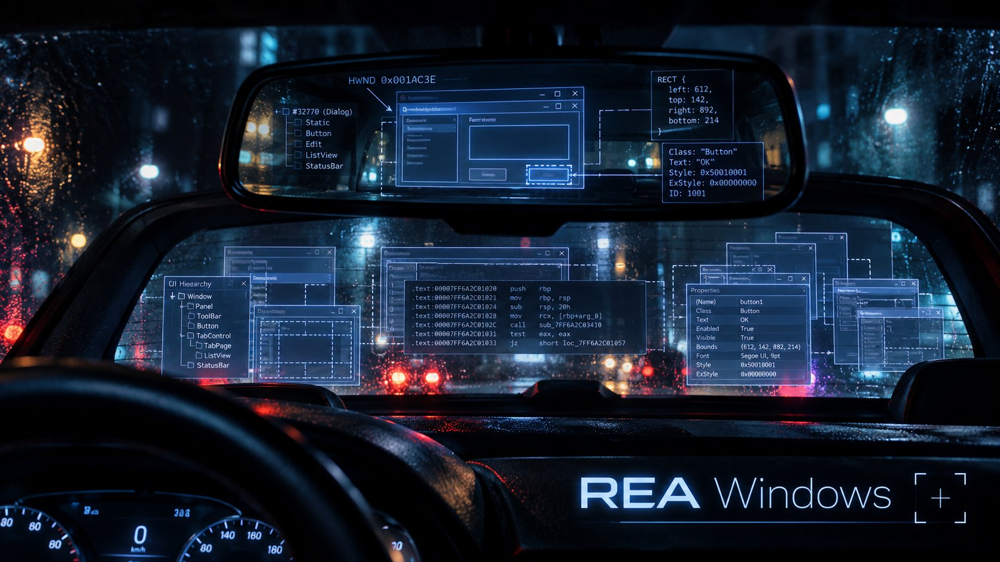
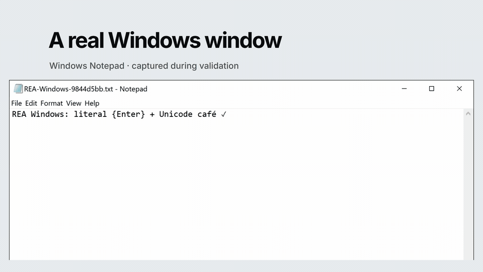

# rea-windows



**Windows native UI provider for [REA](https://github.com/morluto/rea)** — observes and drives already-running Windows application windows through UI Automation, emitting REA's existing evidence envelopes.

This repository adds Windows implementations of `observe-native-ui` and
`capture-native-ui-scenario` to a separate REA source checkout. It contains the
provider sources and Python helper; it is not a standalone copy of REA.

[Watch the animated demo](#demo-video).

```
app window ──► UIA tree ──► nativeUiSnapshot envelope ──► REA evidence
                 (Python        (integer node paths,
                  helper)        pattern actions, PNG+sha256)
```

## What it does

- **Observe** a window: a bounded accessibility tree with integer node paths, UIA pattern names, node values, a PNG screenshot with a SHA-256 digest when available, and process metadata.
- **Drive** a window with explicit `click`, `key-entry`, `scroll`, and `wait` steps. Each step records a before snapshot; completed steps also record an after snapshot.
- **Report failure and gaps**: missing Python dependencies fail the operation. Unavailable screenshots and truncated trees are represented in the evidence.

## Requirements

- Windows with an interactive desktop session. The target application must be running when observing it.
- Python 3.10+ with `uiautomation` and `Pillow`.
- Git for Windows, including Git Bash, for the installer.
- A REA source checkout and its pinned Node.js/npm toolchain. Read that checkout's `.nvmrc` and `package.json`; this addon has no standalone npm project at its root.

## Windows setup

Run these commands in PowerShell. The two repositories are siblings in this
example; the installer also accepts another existing REA checkout.

```powershell
git clone https://github.com/Northernator/rea-windows.git
git clone https://github.com/morluto/rea.git
Set-Location rea-windows

py -3 -m venv .venv
.\.venv\Scripts\python.exe -m pip install uiautomation pillow
$env:REA_WINDOWS_PYTHON = (Resolve-Path .\.venv\Scripts\python.exe).Path

.\install.ps1 ..\rea
Push-Location ..\rea
npm ci
npm run compile
Pop-Location
```

`install.ps1` launches the bundled `install.sh` using Git Bash. If PowerShell's
script policy blocks it, run `bash ./install.sh ../rea` from Git Bash with the
chosen Python interpreter on PATH or `REA_WINDOWS_PYTHON` set there.

The installer copies the helper, provider sources, and tests, registers the
provider, adds the Python files to REA's package manifest, and removes the two
Windows UI operations from macOS provider declarations on Windows. It retains
original files under the REA checkout's `.rea-windows-backup` directory and can
be run again without duplicating registration. Review the checkout's diff after
installation. Source-layout transformations are validated before target files
are written.

Some older REA revisions need the historical `uniqueBy` repair; the installer
restores the helper only when it is referenced and the known source layout matches.
The bundled `fix-uniqueBy.patch` also contains that repair for manual review.
The REA revision recorded in [validation notes](docs/validation.md) does not need
that patch.

For provider operations, Python is located via `REA_WINDOWS_PYTHON`, then
`HARNESS_FORGE_PYTHON`, then `PYTHON`, then `python`/`python3`/`py` on PATH.
An environment variable must contain an executable path, without extra arguments.
The installer itself uses `REA_WINDOWS_PYTHON` or `python` on PATH.

`npm run compile` builds the runtime used by this Python UI provider. REA's
broader `npm run build:cached` pipeline can also require Windows native-addon
artifacts omitted from its Git checkout. Follow REA's
[matching-version artifact recovery guide](https://github.com/morluto/rea/blob/b7f8bbb49fbb675c392e346c9c0c1b56670ab680/native/windows/README.md#restore-the-artifact-in-a-source-checkout)
if that pipeline reports a missing `native/windows/build` manifest or addon.

## Use

The included Notepad CLI example launches a fresh, uniquely named document,
discovers its PID, HWND, executable, and editor path, then calls the real REA CLI
for both observation and key entry:

```powershell
# from rea-windows, after the setup above
& $env:REA_WINDOWS_PYTHON .\examples\notepad_cli.py --rea-checkout ..\rea --output-dir .\artifacts\notepad
```

It requires exact UI text read-back and verifies each saved PNG's SHA-256 digest.
The default text includes literal `{Enter}` and Unicode to exercise text entry.
Use `--text "your text"` to change it. The example leaves its own document open
with unsaved UI edits; it does not type into an existing document. Choose a fresh
output directory for each run to keep earlier evidence.

Outputs are `observe.json`, `scenario.json`, `before.png`, `after.png`,
`summary.json`, the disposable `.txt` file, and CLI stderr logs.

For another already-running application, use its actual executable, PID, and
HWND. For example, from the REA checkout in PowerShell, replace these values:

```powershell
node .\scripts\rea.mjs observe-native-ui "C:\path\App.exe" --pid 1234 --window-id 567890 --json
```

`capture-native-ui-scenario` accepts the same target options plus `--steps`, a
JSON array of actions. Integer node paths must come from a recent observation of
that window; paths can change when the interface changes. See
[the Notepad example](examples/notepad_cli.py) for subprocess argument handling.

| Step kind | Fields | Behavior |
| --- | --- | --- |
| `click` | `path` | Uses Invoke, then SelectionItem for controls such as tabs. |
| `key-entry` | `path`, `text` | Tries ValuePattern, then focused literal text entry; verifies read-back. |
| `scroll` | `path`, `direction` | Uses the control's Scroll pattern; direction is `increment` or `decrement`. |
| `wait` | `milliseconds` | Waits within the configured operation deadline. |

## Demo video



30-second silent GIF of the real Notepad test, including literal `{Enter}` and
Unicode text read-back. [Download the GIF](demo/REA-Windows-demo.gif).

The [HyperFrames demo](demo/README.md) uses the captured Notepad screenshots and
CLI evidence. Its source includes the assets needed to preview or render it:

```powershell
Set-Location demo
npm run dev
# Or render a local MP4
npm run render -- --quality delivery --output REA-Windows-demo.mp4
```

See the demo README to refresh its evidence after a new Notepad smoke test.
Include the [music credits](demo/CREDITS.md) when publishing the film.

## Validation and limitations

The latest local run passed observation and exact literal/Unicode key-entry
through the real REA CLI against Notepad on Windows 10: 26 UIA nodes and
1955 × 1486 PNG evidence. The host, REA revision, commands, results, and reproduced
bugs are recorded in [validation notes](docs/validation.md). Click and scroll have
unit coverage; they were not tested live in this run.

- UIA only exposes what an application provides. Custom canvas controls may have little useful accessibility data.
- The default tree budget is 500 nodes, with a depth limit of 24. Inspect `truncated` and `gaps` before treating a tree as complete.
- Screenshots may be unavailable for minimized or occluded windows. Review the screenshot and its gaps; a matching digest proves the captured bytes, not visual completeness.
- Scenarios change live application state and record `restore: "leave-as-is"`. The provider does not undo edits, clicks, or scrolling.
- Keep the target visible and at a compatible privilege level. Elevated apps or restricted desktops may reject UI Automation access.
- Avoid concurrent keyboard or mouse use during a scenario; focused keyboard entry depends on the target retaining focus.

## Tests

```powershell
# From rea-windows: helper tests stub UIA, so no application is driven
& $env:REA_WINDOWS_PYTHON -m unittest discover -s bridge -p test_rea_native_ui_windows.py -v
& $env:REA_WINDOWS_PYTHON -m unittest discover -s tests -p test_install.py -v

# From the installed REA checkout
npm run test:local -- src/native/NativeWindowsProvider.test.ts src/native/NativeUiObservationWindows.test.ts src/native/NativeUiHelperRuntimeWindows.test.ts
npm run compile
```

## REA constraints worth knowing

Discovered while building this; they shape any future provider:

1. **Auxiliary providers must declare disjoint operations.** `SessionProviderRouter`
   asserts it over *declared* capabilities regardless of availability. The Windows
   provider declares no operations off Windows. The installer removes only the
   two Windows-owned UI operations from macOS declarations on Windows, preserving
   the other capability descriptors.
2. **`execFileOutput` has no stdin.** Helper parameters travel as a temp file
   (argv), which also matches how REA passes scenario JSON elsewhere.
3. **`execFileOutput` resolves `{stdout: string}`**, not a Buffer.
4. **REA revisions may need a compatibility repair.** The bundled
   `fix-uniqueBy.patch` restores a missing helper in
   `src/application/ReconstructionObligationCandidates.ts`, preserving the first
   occurrence when deduplicating. The installer performs the same repair when
   needed and when the known source layout matches.
5. **Scenarios change live application state.** The provider runs only the explicit
   steps supplied by the caller. It records `restore: "leave-as-is"`; it does not
   undo typing, clicks, or scrolling. Observe first and use a disposable document
   when testing.

## Layout

```
bridge/rea_native_ui_windows.py       UIA helper (the workhorse)
bridge/test_rea_native_ui_windows.py  helper unit tests, uiautomation stubbed
src/native/NativeWindowsProviderMetadata.ts   identity + capabilities
src/native/NativeUiHelperRuntimeWindows.ts    interpreter probe + invocation
src/native/NativeUiObservationWindows.ts      envelope validation
src/native/NativeWindowsProvider.ts           provider + client
examples/notepad_cli.py              real REA CLI smoke test against Notepad
install.ps1                          PowerShell entry point (uses Git Bash)
install.sh                           copy + register into a REA checkout
fix-uniqueBy.patch                   REA compatibility patch
docs/validation.md                   validation scope and results
demo/                               HyperFrames demo source and captured assets
```

## Status

This is a separate provider overlay, with the provider sources here as the source
of truth. REA's internal interfaces and installer anchors may change between
revisions. Keep the REA checkout's changes reviewable and check compatibility
before updating it.

## License

MIT.
